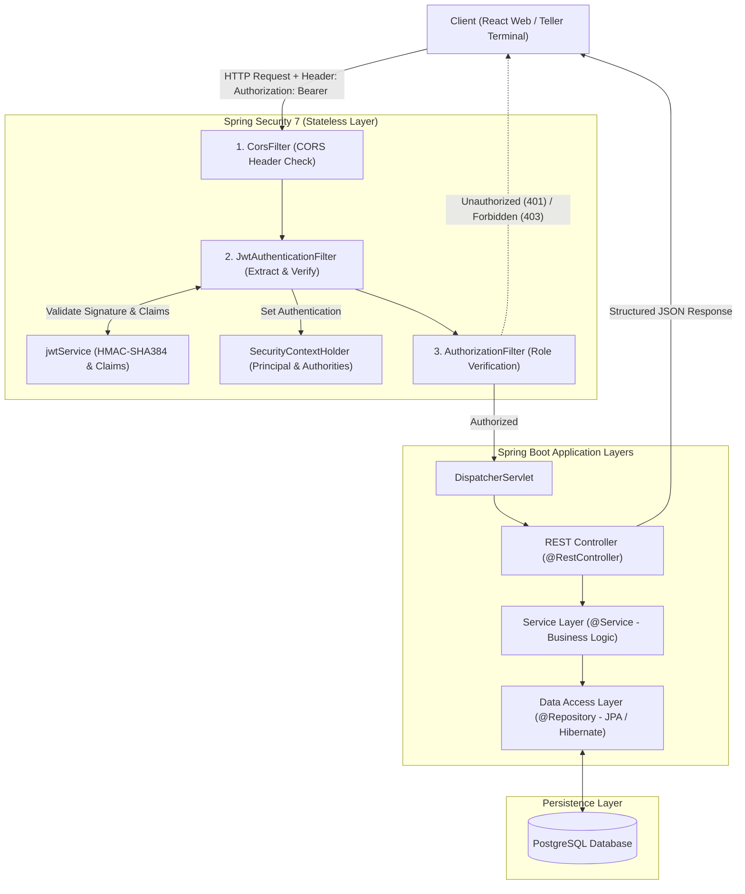
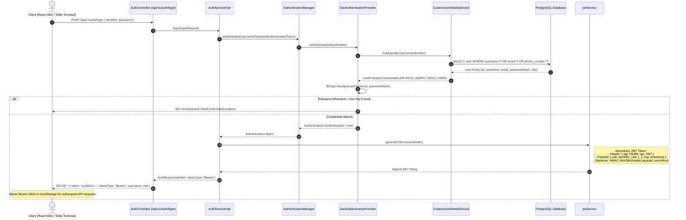
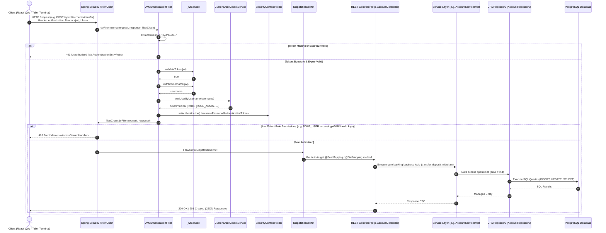
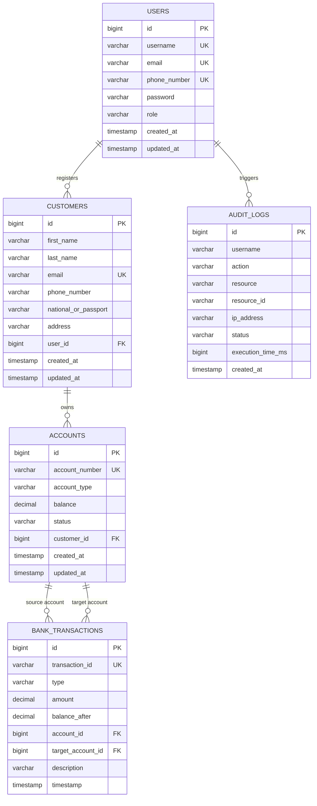

# Banking System - Core Banking REST API

A production-grade, secure Core Banking System backend built with **Spring Boot 4**, **Java 21**, **PostgreSQL**, **Flyway**, and **Spring Security (JWT)**.

> 🌐 **Live Web Client (UI)**: [https://banking-system.yimlemeng.workers.dev](https://banking-system.yimlemeng.workers.dev)  
> 📚 **API Swagger Documentation**: [https://lemeng-banking-api.duckdns.org/swagger-ui.html](https://lemeng-banking-api.duckdns.org/swagger-ui.html)  
> 🏛️ **Frontend UI Repository**: [https://github.com/YimLemeng/Banking-system-UI](https://github.com/YimLemeng/Banking-system-UI)  
> 👤 **Test Accounts**: `admin` / `admin123` (Admin) • `teller` / `teller123` (Teller)

---

## 🚀 Key Features

- **Authentication & Authorization**:
  - JWT Bearer Token based authentication.
  - Role-based Access Control (`ROLE_ADMIN`, `ROLE_USER` / Teller).
  - BCrypt password hashing.
  - Pre-flight security filters & custom unauthorized JSON error handling.

- **Customer KYC Management**:
  - Full CRUD for bank customer profiles.
  - Dynamic multi-column search (name, email, phone, passport/national ID).
  - Spring Data JPA pagination & dynamic sorting.

- **Account Operations**:
  - Savings and Checking account creation with automated unique account number generation.
  - Transaction ledger: Deposits, Withdrawals, and Inter-account Transfers.
  - Balance safety validations with transaction rollbacks.

- **Audit & Compliance**:
  - Automated audit log capturing user actions, IP addresses, resource targets, and execution timestamps.

- **Database Migration**:
  - Version-controlled schema migrations with **Flyway** (`db/migration/V1__init_schema.sql`).

- **Interactive API Documentation**:
  - Swagger UI & OpenAPI 3.1 documentation.

---

## 🛠️ Tech Stack

- **Language & Framework**: Java 21, Spring Boot 4.1.1
- **Database**: PostgreSQL 18+
- **Database Migration**: Flyway 12.4.0
- **ORM & Data Access**: Hibernate 7, Spring Data JPA
- **Security**: Spring Security 7, JJWT 0.13.0
- **Documentation**: Springdoc OpenAPI / Swagger UI 2.8.5
- **Build Tool**: Apache Maven

---

## 🔐 Security Architecture & Request Flow

The backend uses **stateless token-based authentication** powered by Spring Security 7 and JSON Web Tokens (JJWT). The server does not store user sessions in memory; instead, every client request carries a digitally signed cryptographic token.

### 1. High-Level Request Pipeline



---

### 2. User Authentication Flow (Login & Token Issuance)

When a user signs in, credentials are submitted, verified with BCrypt against the PostgreSQL database, and a cryptographically signed JWT is returned to the client:



---

### 3. Authenticated Request Flow (Accessing Protected Endpoints)

For subsequent requests (e.g. depositing cash, withdrawing funds, creating accounts, transferring balances), the client sends the token in the `Authorization` header:



---

### 4. End-to-End Workflow Summary

1. **User Authentication (Login)**:
   - **Client Request**: The client application (React Web or Teller Terminal) sends `identifier` (username, email, or phone) and `password` via `POST /api/v1/auth/login`.
   - **Credential Verification**: `AuthenticationManager` delegates to `DaoAuthenticationProvider`, which fetches user credentials through `CustomUserDetailsService` and validates the password against the stored database hash using `BCrypt`.
   - **Token Generation**: Upon successful authentication, `jwtService` crafts a cryptographically signed **JWT Access Token** embedded with the subject, role (`ROLE_ADMIN`, `ROLE_USER`), issue timestamp, and expiration time, digitally signed using HMAC-SHA384.
   - **Token Storage**: The server returns an `AuthResponse` object containing the `token`. The client securely stores the token in `localStorage` to authenticate subsequent requests.

2. **Authenticated Client Request Execution**:
   - **Header Attachment**: For every subsequent protected API call (e.g., managing customer KYC, opening accounts, executing deposits/withdrawals/transfers), the client attaches the HTTP header `Authorization: Bearer <token>`.
   - **Filter Interception**: `JwtAuthenticationFilter` intercepts the request before it reaches any controller:
     - **Missing or Expired Token**: Immediately rejected with **401 Unauthorized** via custom `AuthenticationEntryPoint`.
     - **Valid Token**: Extracts user details, constructs a `UsernamePasswordAuthenticationToken`, and injects it into `SecurityContextHolder`.
   - **Role-Based Authorization (RBAC)**: Spring Security verifies endpoint permissions:
     - **Insufficient Privileges** (e.g., a `ROLE_USER` attempting to delete a customer profile or inspect system audit logs): Immediately rejected with **403 Forbidden**.
     - **Authorized**: The request is routed through the Spring MVC pipeline:
       `DispatcherServlet` &rarr; `@RestController` &rarr; `@Service` (Business Logic & Atomic `@Transactional`) &rarr; `@Repository` (JPA / Hibernate) &rarr; `PostgreSQL Database`.
   - **Structured Response**: The business logic executes, ledger updates are committed, and the controller returns structured JSON with HTTP status code `200 OK` or `201 Created` back to the client.

---

### 5. Entity-Relationship Diagram (Database Schema)



---

## 🐳 Docker Quickstart (Recommended)

Run both the Database (PostgreSQL) and the Backend API together with a single command:

```bash
# 1. Copy environment template
cp .env.example .env

# 2. Build and start containers
docker compose up -d --build
```

The services will start automatically:
- **Backend API**: `http://localhost:8080`
- **Swagger Documentation**: `http://localhost:8080/swagger-ui.html`
- **PostgreSQL Database**: `localhost:5432`

To stop:
```bash
docker compose down
```

---

## 📦 Getting Started (Local Development)

### 1. Prerequisites
- Java 21 (JDK 21)
- Docker (for PostgreSQL) or local PostgreSQL instance
- Maven 3.9+ (or use included `./mvnw`)

### 2. Database Setup
Start PostgreSQL via Docker:
```bash
docker run --name postgre-db \
  -e POSTGRES_DB=banking_system_db \
  -e POSTGRES_USER=banking_system \
  -e POSTGRES_PASSWORD=your_secure_password \
  -p 5432:5432 -d postgres:17-alpine
```

### 3. Local Configuration & Secrets
Sensitive credentials (database password, JWT secret) are never stored in git.
For local development, create `src/main/resources/application-local.yaml` (which is excluded in `.gitignore`):
```yaml
spring:
  datasource:
    password: your_database_password

app:
  jwt:
    secret: your_256_bit_jwt_secret
```

### 4. Run Application
```bash
./mvnw spring-boot:run
```

The application starts on port `8080`.

---

## 📚 API Documentation

Interactive OpenAPI / Swagger UI documentation is available at:
- **Production Server**: [https://lemeng-banking-api.duckdns.org/swagger-ui.html](https://lemeng-banking-api.duckdns.org/swagger-ui.html)
- **Localhost Development**: [http://localhost:8080/swagger-ui.html](http://localhost:8080/swagger-ui.html)

---

## 🔐 Core Endpoints Overview

| Method | Endpoint | Description | Access |
|---|---|---|---|
| `POST` | `/api/v1/auth/register` | Register new user account | Public |
| `POST` | `/api/v1/auth/login` | Authenticate user credentials & return JWT | Public |
| `GET` | `/api/v1/customers` | Get paginated customers with search | Authenticated |
| `POST` | `/api/v1/customers` | Register customer KYC profile | Authenticated |
| `POST` | `/api/v1/accounts` | Open depository account | Authenticated |
| `POST` | `/api/v1/accounts/deposit` | Teller deposit operation | Authenticated |
| `POST` | `/api/v1/accounts/withdraw` | Teller withdrawal operation | Authenticated |
| `POST` | `/api/v1/accounts/transfer` | Inter-account fund transfer | Authenticated |
| `GET` | `/api/v1/audit-logs` | Query system audit logs | Admin Only |

---

## 📄 License
This project is licensed under the Apache License 2.0.
